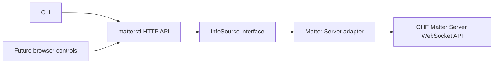

# matterctl architecture

matterctl is a service with a CLI client and an eventual browser interface.
The service owns one persistent OHF Matter Server WebSocket connection. CLI
commands use the HTTP API, including when the CLI runs on the same host.

## Package boundaries

| Package | Responsibility |
| --- | --- |
| `cmd/matterctl` | Process exit and signal handling |
| `internal/cli` | Cobra commands, Viper configuration, human/JSON output |
| `internal/client` | Context-aware HTTP API client |
| `internal/api` | Shared response types and the `InfoSource` application interface |
| `internal/server` | HTTP API and browser placeholder |
| `internal/matter` | WebSocket handshake, schema compatibility, RPC correlation, connection lifecycle |
| `internal/app` | Adapter construction and coordinated lifetimes |

Cobra and Viper remain at the CLI boundary. The HTTP server depends on the
small application interface, allowing tests to exercise API behavior without
a live Matter network. The WebSocket adapter implements that interface.

## Connection lifecycle

`app.Serve` starts the upstream connection and HTTP server together. HTTP
startup does not wait for Matter Server. Failure to bind HTTP cancels and joins
the background connection; process cancellation stops both adapters.

The upstream handshake has a five-second deadline, including receipt of the
initial server information. Compatibility requires an overlap between the
upstream's schema range and the client's supported range, 11 through 14. This
phase uses `server_info`, available throughout that range. Future commands must
account for the schema versions and features they require.

A single reader handles WebSocket frames. Requests have unique message IDs and
individual response channels, so concurrent callers can receive responses out
of order. Unsolicited events and responses to canceled requests are separated
from active replies. Device event consumption is a later phase; this version
does not call `start_listening` or maintain device inventory.

Each upstream RPC has a two-second maximum. Canceling a caller while it waits
for a reply removes its pending request without canceling the shared reader.
A failed or canceled socket write can terminate the connection, as required by
the WebSocket library. Session loss releases all pending callers. Reconnection
uses exponential backoff with jitter, capped at 30 seconds; failed requests are
never replayed. Cancellation interrupts both connection attempts and backoff.

`server info` performs a fresh `server_info` round trip rather than treating a
successful handshake as proof that the peer is still responsive. Metadata from
closed sessions is cleared. `/healthz` checks the HTTP process separately from
upstream connectivity.

## Observability

Lifecycle messages use `log/slog`; HTTP access is not logged. API responses
expose a selected set of version and capability fields, without fabric
identifiers, pairing codes, or arbitrary upstream error messages/details.

The HTTP client, API operation, WebSocket handshake, and upstream RPC have
OpenTelemetry spans with injectable tracers. HTTP boundaries and the WebSocket
upgrade propagate W3C trace context. The upstream message protocol has no trace
context field, so per-message spans remain local to matterctl. No exporter is
configured by the binary yet; instrumentation uses the default provider.
Request payloads, full URLs, and raw upstream errors are excluded from spans.

## Validation

`task validate` runs formatting, lint, race tests, and the build. Controlled
WebSocket peers exercise reply correlation, unsolicited events, late replies,
deadlines, disconnections, compatibility, reconnect, and shutdown. HTTP and CLI
tests cover status codes, JSON output, configuration, cancellation, and trace
propagation. Live verification uses a read-only information request against the
installed Matter Server.

The remaining milestones and control semantics are in [PLAN.md](PLAN.md).
