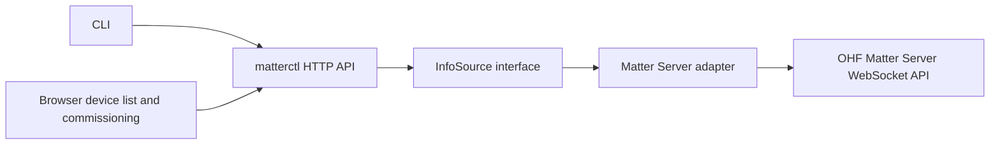

# matterctl architecture

matterctl is a service with a CLI client and a browser device list with
network-only commissioning.
The service owns one persistent OHF Matter Server WebSocket connection. CLI
commands use the HTTP API, including when the CLI runs on the same host.

## Package boundaries

| Package | Responsibility |
| --- | --- |
| `cmd/matterctl` | Process exit and signal handling |
| `internal/cli` | Cobra commands, Viper configuration, human/JSON output |
| `internal/client` | Context-aware HTTP API client |
| `internal/api` | Shared types and small source interfaces |
| `internal/server` | HTTP API and embedded browser assets |
| `internal/matter` | WebSocket session, inventory, capability projection, subscriptions, and commissioning |
| `internal/automation` | Starlark rule registration, normalized triggers, and action-plan previews |
| `internal/app` | Adapter construction and coordinated lifetimes |

Cobra and Viper remain at the CLI boundary. The HTTP server depends on the
small application interface, allowing tests to exercise API behavior without
a live Matter network. The WebSocket adapter implements that interface.

The Matter adapter resolves exact node and bridged endpoint labels for
inspection, event filtering, and control. It writes supported Matter NodeLabel
attributes and confirms them with a fresh read. Numeric node and endpoint IDs
remain available for disambiguation. Matter Server owns label persistence.

The automation engine loads Starlark programs from an XDG config directory at
service startup. It consumes projected inventory and event frames, normalizes
occupancy and Switch signals, and evaluates bounded handlers into action plans.
The Matter adapter executes planned actions through the same session used by
the API, checking advertised commands and reading back the resulting state.
CLI `automation watch` and `replay` use the same engine in preview mode and do
not send actions. Target resolution uses exact labels or node IDs and does not
retarget an existing reference after a connection snapshot changes.

The browser assets are embedded in the Go binary. The page reads the inventory
endpoint and the unfiltered NDJSON event stream from the same origin. Stream
snapshots replace the local view; node and endpoint updates reconcile by ID.
Cards classify endpoints from Matter device types and server clusters, display
allowlisted readings, and retain the latest Switch action only in browser memory.
Browser light controls are gated by advertised accepted commands and use
confirmed reads through the existing Matter Server session. Confirmed reads
update the cached projection and publish an attribute update so cards do not
wait for a separate subscription report. The browser and
service store no room or endpoint-name aliases; optional FixedLabel,
UserLabel, and Descriptor semantic tags are projected from Matter data.
After a stream interruption or Matter Server disconnect, the page marks cached
states as stale until a new inventory snapshot is received.
Its commissioning panel sends a single same-origin JSON request and refreshes
inventory after the result. Stopping the browser wait cannot establish that
Matter Server stopped commissioning.

## Connection lifecycle

`app.Serve` starts the upstream connection and HTTP server together. HTTP
startup does not wait for Matter Server. Failure to bind HTTP cancels and joins
the background connection; process cancellation stops both adapters.

The upstream handshake has a five-second deadline, including receipt of the
initial server information. Compatibility requires an overlap between the
upstream's schema range and the client's supported range, 11 through 14. This
phase uses `server_info` and `start_listening`, available throughout that range. Future commands must
account for the schema versions and features they require.

A single reader handles WebSocket frames. Requests have unique message IDs and
individual response channels, so concurrent callers can receive responses out
of order. Unsolicited events and responses to canceled requests are separated
from active replies. Each session sends `start_listening` before accepting
application requests and has ten seconds to receive its snapshot. The reader
applies the snapshot and subsequent updates in wire order. Updates arriving
before the snapshot reply are bounded, buffered, and applied before readiness.

Ordinary upstream RPCs have a two-second maximum. Canceling a caller while it waits
for a reply removes its pending request without canceling the shared reader.
A failed or canceled socket write can terminate the connection, as required by
the WebSocket library. Session loss releases all pending callers. Reconnection
uses exponential backoff with jitter, capped at 30 seconds; failed requests are
never replayed. Cancellation interrupts both connection attempts and backoff.

`server info` performs a fresh `server_info` round trip rather than treating a
successful handshake as proof that the peer is still responsive. Metadata from
closed sessions is cleared. `/healthz` checks the HTTP process separately from
upstream connectivity.

## Inventory and event streams

The adapter holds the last node snapshot and applies node, endpoint, and
attribute updates under one lock. Inventory is ready only after a valid snapshot
has been applied to the current session. A disconnection marks it stale; the
previous data remains available diagnostically with HTTP 503 until a new snapshot
replaces it. Target resolution and inspection reject stale inventory.

Projection exposes device labels, endpoint parents, device types, server/client
cluster roles, advertised commands/features, and selected state. Node IDs and
64-bit event counters/timestamps are strings in the application API. Attribute
values are limited to identity labels and allowlisted OnOff, LevelControl,
Switch, OccupancySensing, TemperatureMeasurement, RelativeHumidityMeasurement,
and PowerSource battery state. The decoder list in
`internal/matter/state.go` maps cluster and attribute IDs to normalized scalar
values and display text. Adding another standard state means adding its ID
constants and decoder; projection and the CLI renderer do not need
device-specific branches. The advertised device type identifies an endpoint
but does not determine how an attribute is decoded. Other attributes contribute
IDs, not their values. Node events
expose metadata and selected standard Switch fields, not arbitrary payloads.

Parent relationships use the upstream `endpoint_parents` when present; a
Descriptor PartsList does not establish a direct parent. Friendly power actions
require a server-side OnOff cluster and the corresponding accepted command.
Unknown command metadata stays distinct from a known empty command list.

Watch registration and its initial snapshot are atomic. Subscribers have queues
of 64 events; a full queue is closed without blocking the shared reader or other
subscribers. HTTP sends a terminal `stream_error` when possible. An interrupted
or truncated stream fails explicitly, and restarting watch obtains a fresh
snapshot. This is live observation, not durable event history.

Streams use NDJSON with 15-second heartbeats. HTTP writes have individual
ten-second deadlines, cleared during idle periods. CLI establishment uses
`request.timeout`; stream duration is bounded by caller cancellation and a
45-second idle timeout, not the initial request deadline. Client disconnect,
Ctrl-C, or service shutdown releases the subscription. Existing streams survive
upstream reconnects and receive a replacement inventory. A node filter is
resolved once and never retargeted to another node because a label changed.

## Discovery and commissioning

The commissioning interface remains separate from inventory and connection
queries. The adapter requires synchronized inventory, uses a bounded 30-second
discovery RPC, and gives commissioning a separate overall wait (default five
minutes, at most ten). These operations extend the ordinary HTTP write deadline.
At most one commissioning caller waits at a time; the shared reader continues
applying inventory events throughout the operation.

Commission replies are projected into the existing safe device DTO. They do not
overwrite the subscription's inventory cache, because a reply can arrive after a
newer attribute report. The subscription remains authoritative. Losing a reply
or canceling the wait does not cancel the remote operation or establish failure;
the caller is told to check inventory before retrying. There is no automatic
replay or persistent job queue.

Pairing codes are bounded, validated, and passed only to `commission_with_code`.
They bypass configuration and never enter logs, trace attributes, or events.
Upstream errors retain numeric codes and allowlisted reasons, with arbitrary
details discarded. HTTP commission bodies require JSON and reject unknown fields.
The HTTP client rejects redirects to avoid forwarding or replaying request bodies.
The commission endpoint rejects a browser request whose Origin differs from
its scheme and Host. Requests without Origin remain available to CLI clients.

## Observability

Lifecycle messages use `log/slog`; HTTP access is not logged. API responses
expose a selected set of version and capability fields, without fabric
identifiers, pairing codes, or arbitrary upstream error messages/details.

The HTTP client, API operation, WebSocket handshake, and upstream RPC have
OpenTelemetry spans with injectable tracers. HTTP boundaries and the WebSocket
upgrade propagate W3C trace context. The upstream message protocol has no trace
context field, so per-message spans remain local to matterctl. No exporter is
configured by the binary yet; instrumentation uses the default provider.
Request payloads, full URLs, and raw upstream errors are excluded from spans.

## Validation

`task validate` runs formatting, lint, race tests, and the build. Controlled
WebSocket peers exercise reply correlation, unsolicited events, late replies,
deadlines, disconnections, compatibility, reconnect, and shutdown. HTTP and CLI
tests cover status codes, JSON output, configuration, cancellation, and trace
propagation, stream lifetime, snapshot ordering, large IDs, metadata projection,
and backpressure. Live verification uses read-only information and subscription
requests against the installed Matter Server.

The remaining milestones and control semantics are in [PLAN.md](PLAN.md).
